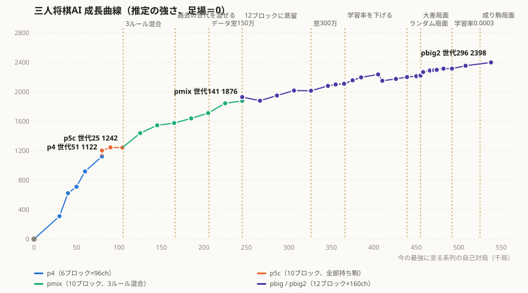

# 学習の経緯と結果

実行（`runs/<実行名>/`）ごとの設定・強さ・分かったこと。数字は `log.txt` / `eval.jsonl` / `eval_extra.jsonl` から。

評価はすべて **1体 vs 同じ相手2体**（席は毎局入れ替え、互角なら33.3%）。z は互角からのずれ。局数ごとの誤差（95%）の目安：60局 ±12ポイント、150局 ±7、300局 ±5。

## 成長曲線



各段階の強さを、直前の段階との直接対戦（1体 vs 同じ相手2体）の勝率 p から積み上げた推定値（足場＝0）。強さの比を 2p/(1−p)（3人の勝ち確率がそれぞれの強さに比例するとみなす、Luce の選択モデル）とし、その対数の400倍を差にした。互角（33.3%）で0、40%で約+50、50%で約+120。評価1回は150〜600局なので1段ごとに±20〜40、積み上げた終点では±80ほどぶれる。描画は `python/scripts/plot_growth.py`（新しい評価を足して実行すると描き直せる）。

## 強さの流れ

```
足場のMCTS（駒価値だけ）
  < p4 世代1（足場の対局から蒸留、6ブロック×96ch）
  < p4 世代51（強化学習 50世代）
  < p5c 世代1（p4 世代51の出力から蒸留、10ブロック×128ch）
  < p5c 世代11 < p5c 世代20 < p5c 世代25 ≒ 世代30
  < pmix 世代21（3ルールを混ぜて学習。全部持ち駒ルールでも p5c より強い）
  < pmix 世代61
  < pmix 世代81 < pmix 世代101（自己対局に過去の世代を混ぜる）
  < pmix 世代121（データ窓を150万局面に）
  < pmix 世代141
  < pbig2 世代61（pmix 世代141の出力から 12ブロック×160ch に蒸留して強化学習）
  < pbig2 世代101（データ窓300万局面） < pbig2 世代140（学習率 0.002 → 0.0007）
  ≒ pbig2 世代165 ≒ 世代181 ≒ 世代197（横ばい）
  < pbig2 世代213（ランダム局面・他のモデル入りを混ぜる）
  < pbig2 世代224（大差局面から指し直す対局を混ぜる）
  < pbig2 世代240（探索で玉を取る手を必ず読む）   ← 今の最強
```

## 早期の実行（p3_first, p3_second）：強化学習だけでは足場を超えられなかった

- 足場の評価器（駒価値のMCTS、[self_play.md](self_play.md)）で2000局を作り、そこから自己対局の強化学習を回した。1世代500局。
- **p3_first**（10ブロック×128ch）：価値が過学習した。学習データでは序盤でも勝敗を74〜81%当てるのに、未学習のデータでは当たらない（価値損失 2.11 vs 学習時 0.12）。三人では序盤の勝敗の偶然が大きく、対局ごとの結果を丸暗記した。足場のMCTSに0〜1.7%。
- **p3_second**（6ブロック×96ch）：過学習の対策を入れた（価値の教師に MCTS 根の価値を半分混ぜる q_mix=0.5、ネットを小さく、学習量を新しい局面数に比例、重み減衰 1e-4）。過学習は収まったが、足場のMCTSに3〜8%と弱いまま。
- → 数千局の強化学習ではネットが足場に追いつかない。先に足場を大量に真似させる（蒸留）ことにした。

## p4：足場からの蒸留 → 強化学習 50世代（6ブロック×96ch）

- **蒸留**（`pretrain_scaffold.py`）：足場の対局3万局（465万局面）で2周。検証の価値正解率63%。**足場のMCTSに75.0%**（60局）。
- **強化学習**（`train_loop.py`）：1世代1000局、データ窓60万局面、学習率0.02。1世代約7.5分。
- 評価（60局）：

| 世代 | vs 足場 | vs 世代1 |
|---|---|---|
| 11 | 58.3% | 75.0% |
| 21 | 80.0% | 83.3% |
| 27 | 90.0% | 90.0% |
| 30 | 78.3% | 88.3% |

  | 世代 | vs 世代21 | vs 世代31 |
  |---|---|---|
  | 36 | 70.0% | 58.3% |
  | 45 | 81.7% | 61.7% |
  | 51 | 75.0% | 61.7% |

- 世代12〜18は横ばい、世代21で一気に伸びた。世代36以降は世代31相手に55〜62%で頭打ち。
- 世代11では「世代1には勝つが足場にはあまり勝てない」（相性の偏り）が見えたが、世代21以降は両方に勝つようになり解消した。
- 平均手数は約80〜110手、500手打ち切りはほぼ0。入玉勝ちは約15〜25%。

## p5 / p5b：大きいネットへの蒸留の失敗

p4 の世代41〜51の自己対局データ（115万局面）で、10ブロック×128ch のネットを蒸留した。

- **p5**（2周、教師は実際の勝敗）：学習不足。p4 世代51に18.3%。さらに強化学習を学習率0.02で始めたら崩れた（世代3が蒸留直後の世代1に11.7%）。蒸留の最後の学習率（0.002）から急に10倍にしたため。
- **p5b**（8周、教師は実際の勝敗）：方策は良くなった（検証の方策損失 2.90）が、価値が過学習した（学習データで正解率85%、検証で54%）。同じ対局を何周も見て勝敗を丸暗記した。p4 世代51に23.3%。

## p5c：先生ネットの出力からの蒸留 → 強化学習 30世代（10ブロック×128ch）

- **蒸留**（`pretrain_scaffold.py --teacher p4:51`）：教師を実際の勝敗ではなく、**p4 世代51のネットの出力**（方策・価値・補助）にした。価値は先生の価値と MCTS 根の価値を半分ずつ。8周。
  - 検証：方策損失 **2.84**、価値損失 **0.814**（正解率59%）。どちらもこれまでで最良。先生と最善手が一致する割合79%。
  - **p4 世代51（先生）に55.0%**（60局）。大きいネットが先生を超えた。
- **強化学習**：最初の3世代は学習率0.002、以降0.005。1世代約13〜16分（p4 の約2倍。推論が遅い）。
- 評価（150局）：

| 世代 | vs p4 世代51 | vs p5c 世代1 |
|---|---|---|
| 15 | 52.7% | 40.0% |
| 20 | 45.3% | 47.3% |
| 25 | 50.0% | 46.0% |
| 30 | 47.3% | 40.7% |

- 300局の評価：世代11 vs p4 世代51 50.3%、世代1 vs p4 世代51 44.3%、世代11 vs 世代1 34.0%（互角）。
- 総当たり（300局）：世代25 vs 世代20 **47.7%**、世代30 vs 世代20 **43.0%**、世代25 vs 世代30 32.3%（互角）。→ **世代25 ≒ 世代30 が最強**。世代25〜30で頭打ち。
- 人が指した感想：十分強い。たまに駒のただ捨てに見える手がある（三人では相手の応じ方の読みが人と違う可能性もあり、損とは限らない）。

## 学習していないルールへの通用（p5c 世代25）

「全部持ち駒」だけで学習したネットを、ほかのルールで指させた（探索はルールどおりに読む。ネットはルールを知らない）。

| ルール | vs 足場（60局） | vs p4 世代51（150局） |
|---|---|---|
| 全部持ち駒（学習したルール） | 81.7% | 44〜50%（p5c 世代1〜11、300局） |
| お裾分け | 75.0% | **50.0%** |
| 消滅あり | 70.0% | **50.0%** |

- 強さの差はルールをまたいでほぼそのまま残った。**強さの大部分はルールに共通の力**（読み、玉の守り、入玉の判断）。
- 消滅ありは決着のつき方がまったく違う。強いネット同士だと150局中97局が入玉勝ち（全部持ち駒では約2割）。駒が消えて攻めきれず、入玉を目指すゲームになる。

## pmix：3つのルールを1つのネットで（10ブロック×128ch）

- ルールをネットの入力に加え（[ai_architecture.md](ai_architecture.md)）、自己対局で3つのルールを均等に混ぜる。p5c 世代25から開始（追加した入力の重みは0なので、開始時点は p5c 世代25と同じ）。学習率は最初の3世代0.002、以降0.005。20世代（世代2〜21）、1世代約16分。
- 評価（vs 世代1＝学習前の p5c 世代25、150局、ルールごとに約50局）：

| 世代 | 全体 | 全部持ち駒 | お裾分け | 消滅あり |
|---|---|---|---|---|
| 5 | 43.3% | 39.2% | 37.3% | 54.2% |
| 10 | 44.0% | 31.4% | 41.2% | 60.4% |
| 15 | 47.3% | 35.3% | 47.1% | 60.4% |
| 20 | **60.7%** | 47.1% | 54.9% | **81.2%** |

- **消滅ありが一番伸びた**。全部持ち駒の感覚が一番合わないルール。世代15→20で一気に伸びた。
- **全部持ち駒ルールでも、全部持ち駒だけで学習したネットより強くなった**（300局）：pmix 世代21 vs p5c 世代25 **44.3%**（z=4.0）、vs p5c 世代30 **39.0%**（z=2.1）。p5c は全部持ち駒だけで世代25〜30が頭打ち（世代30 vs 世代25 は互角）だったので、ほかのルールを混ぜた学習のほうが、元のルールでも伸びた。自己対局のうち全部持ち駒は1/3しかないのに、である。
- ルールの吸収の仕方は [experiments.md](experiments.md) の「ルールの吸収」。

### pmix 世代22〜61：続けて学習

- 世代21を基準にした150局の評価：世代25・30は互角、世代35で45.3%、世代40で48.0%。しばらく横ばい → まとめて伸びる形。
- 世代41を基準に：世代45〜55は37〜41%、世代60で42.7%（150局）。伸びは鈍化。
- 300局の評価で、**強さが一直線に並ばない**ことが分かった：世代61は世代51に44.3%（z=4.0）勝つのに、世代41には38.3%・36.3%（2回）。

### 世代41の「赤狙い」（`analyze_eval.py`、2026-09-30）

- 世代61は、世代41の2体を相手に赤の席に座ると **28.5%**（200局）。青40%・緑43.5%。世代51相手では赤も45%で普通。
- 赤の世代61が**最初に脱落する割合が38〜39%**（他の席・他の相手では15〜31%）。世代41の2体が、そろって赤を先に潰していた。特に全部持ち駒で強く出た（赤の世代61が68局中10勝、15%）。
- 世代41自身の自己対局でも、全部持ち駒で最初に脱落するのが赤だった割合が44%（前後の世代は21〜34%）。**誰を狙うかの流行が世代ごとに巡回**し（世代41で赤狙い→42〜51で消える→61でまた強まる）、過去の流行に巻き込まれると個人の強さに関係なく負ける。これが「強さが一直線に並ばない」中身。

### pmix 世代62〜101：自己対局に過去の世代を混ぜる

- 自己対局の25%で、3席のうち1〜2席を過去の世代にする（`--past-prob 0.25`、半分は 現世代2＋過去1、半分は 現世代1＋過去2）。過去の世代の候補は世代21から10世代ごと（最大6つ）、1世代ごとに1つを順番に使う（`--past-per-gen 1`）。学習データは現世代の手番の局面だけ（[training.md](training.md)）。
  - 最初は1世代で候補5つを同時に使ったら、推論がモデルごとに分かれて約3倍遅くなった（1世代45分）。1つずつにして約23分（混ぜない場合の約1.4倍）。
- 自己対局中、現世代1体 vs 過去の世代2体の勝率（各約120局）：古い世代ほど勝ちやすい（世代21に50%、31に48%、41に46%、51に44.5%、61に31〜33%）。
- 評価（300局、3ルール混合）：

| 対戦 | 勝率 | 席別（青 / 赤 / 緑） |
|---|---|---|
| 世代81 vs 世代61 | **42.0%**（z=3.2） | 42 / 35 / 49 |
| 世代81 vs 世代41 | 40.7%（z=2.7） | 39 / 33 / 50 |
| 世代101 vs 世代81 | **43.0%**（z=3.6） | 36 / 46 / 47 |
| 世代101 vs 世代61 | 41.3%（z=2.9） | 45 / 35 / 44 |

- **赤狙いへの弱さは解消**：世代41の2体を相手に赤に座ったとき、最初に脱落する割合が38〜39%（世代61）→ **16%**（世代81）。
- 強さは 世代61 < 世代81 < 世代101。ただし世代101の世代61に対する勝率（41.3%）は、世代81（42.0%）と変わらない。伸びはゆっくりで、一直線でもない。
- 1世代は約23分、20世代で約8時間。

### 有利な席は「流行」で移る（pmix の自己対局と価値ネット）

- 世代72〜81の自己対局（現世代だけの7,451局）：どのルールでも**緑が最多**（全部持ち駒 39.0%、お裾分け 38.4%、消滅あり 36.6%）、青と赤は約30〜32%。赤が構造的に不利なわけではない。
- 初期局面の価値ネットの予想（全部持ち駒）：世代21は青40.5%、世代61は赤35.6%、世代81は緑36.1%が最大。有利な席が 青 → 赤 → 緑 と移り、実際の自己対局の勝率の流れと一致する。

### pmix 世代102〜121：データ窓を60万 → 150万局面に

- KataGo のように、少し前の世代の対局まで学習に混ぜる（`--window 1500000`、約12世代分）。ほかの設定は世代62〜101と同じ。学習の速さはほぼ変わらない。
- 評価（150局）：世代110 vs 世代81 45.3%、vs 世代101 40.0%。世代120 vs 世代81 **60.7%**（z=7.1）、vs 世代101 **48.0%**（z=3.8）。
- 評価（300局）：

| 対戦 | 勝率 | 席別（青 / 赤 / 緑） | ルール別（全部持ち駒 / お裾分け / 消滅あり） |
|---|---|---|---|
| 世代121 vs 世代101 | **51.7%**（z=6.7） | 59 / 39 / 57 | 47 / 54 / 55 |
| 世代121 vs 世代81 | **46.7%**（z=4.9） | 45 / 49 / 46 | 42 / 51 / 48 |

- 窓を広げる前の20世代（世代81→101）は43.0%だったので、**伸び幅が大きくなった**。
- ここでも一直線ではない：世代121は、1つ前の最強（世代101）には51.7%なのに、2つ前（世代81）には46.7%。

## pbig / pbig2：大きいネット（12ブロック×160ch）

- **蒸留**（pbig）：pmix 世代122〜141の自己対局（231万局面）で、先生 pmix 世代141 の出力から蒸留した。pbig のまま学習率0.005で強化学習を20世代回したが、pmix 世代141 に26〜29%（150局）で伸びなかったので、pbig 世代1 から学習率0.002で始め直したのが **pbig2**。
- 1世代1000局、3ルール混合、過去の世代を混ぜる（世代1から10世代おき、最大6つ）。1世代約23〜40分。
- 評価（300局、1体 vs 同じ相手2体、互角なら33.3%）：

| 期間 | 変えたこと | 主な評価 |
|---|---|---|
| 世代2〜81 | 学習率0.002、データ窓150万局面 | 世代60 vs 21 **49.3%**、vs 41 45.7%。世代80 vs 61 37.0% |
| 世代82〜121 | データ窓300万局面 | 世代100 vs 61 46.0%、vs 81 38.0%。世代110 vs 81 48.0%、vs 101 33.0%。世代120 vs 101 37.3% |
| 世代122〜140 | 学習率 0.002 → 0.0007 | 世代130 vs 120 38.7%。世代140 vs 101 **49.0%**、vs 120 **45.3%**（約+85） |
| 世代141〜165 | 途中で1人に駒を5〜20枚渡して大差の局面を作る（`--gift-prob` 0.3→0.5） | 世代144〜152 vs 140 は33.7〜34.0%（互角）、世代160 vs 140 38.7% |
| 世代166〜197 | 弱いモデルを混ぜる（`--weak-models`）、学習データを山に分ける（`--mix-share` / `--adj-share`） | 世代168〜192 vs 165 は31.0〜37.3%（横ばい）。世代197 vs 181 36.7%、vs 165 40.0%、vs 101 50.0%（各60局） |
| 世代198〜213 | 駒を渡すのをやめ、ランダム局面から5%・他のモデル入り5%（`--rand-share` / `--mix-share`） | 世代208 vs 197 **38.0%**、vs 165 38.3%。世代213 vs 197 36.3%、vs 208 34.3% |
| 世代214〜229 | 大差局面から指し直す対局を2%（`--lead-share`） | 世代216 vs 140 47.7%、vs 213 35.3%。世代224 vs 140 **48.0%**、vs 213 **40.7%**（z=2.7）。世代229 vs 224 34.0%（互角） |
| 世代230〜240 | 探索で玉を取る手を必ず読む（方策の下限0.1）。人の対局の大差局面も候補に足す | 世代232 vs 224 31.7%、vs 140 50.7%。世代240 vs 224 **38.0%**（z=1.7）、vs 140 48.3% |
| 世代241〜250 | 同じ設定で続ける | 世代245 vs 240 26.7%（z=−2.5）、vs 224 37.7%。世代250 vs 240 30.3%、vs 224 40.0%。大差局面から指させても 世代250 vs 240 は人の対局の局面で35.7%、自己対局の大差局面で30.0%（各300局、どちらも互角の範囲） |

- **学習率を下げたのが一番効いた**（世代121〜140で約+85）。
- **駒を渡して大差の局面を作る方法は効かなかった**。実在しない局面を学んでも、実戦の大差の局面の評価は直らなかった。
- 世代140〜197は横ばいだった。**ランダム局面から指す対局・他のモデル入りの対局を混ぜてから**、また伸び始めた（世代208、213）。
- **大差局面から指し直す対局**（自己対局で3人とも生きていて、駒数で12枚以上リードした実際の局面から、今の世代が3人とも指す）を2%足した16世代で、世代213に40.7%。この期間でいちばん大きい伸び。世代229は世代224と互角なので、v1.0 で公開したのは測った回数の多い**世代224**（推定 約2,290）。
- 世代224で一度止めた（v1.0）。その直後、人が世代224に2局勝った。
  - 1局目（人が青）：赤の玉が動いて筋が開き、青の飛車で緑の玉を取れる形になったのに、緑のAIは玉を逃がさなかった。ネットの方策が「遠くの飛車で玉を取る手」にほぼ0を付けていて、探索が一度も読まなかった。→ **盤上の玉を取る手には方策の下限0.1を付けて、必ず読むようにした**（`engine-rs/mcts/src/search.rs`。自己対局・対局サーバー・ブラウザ版の全部）。
  - 2局目（人が緑）：人が持ち駒を20枚以上抱えて逃げ回り、最後は持ち駒を玉の周りに打って固めて勝った。AIはその間、緑の勝ちを25〜33%と低く見ていた（[findings.md](findings.md) の「駒数でリードしていても勝てない」の人間側の例）。
  - この2局と10/10の対局の大差局面（315局面）を、「大差局面から」の候補に足せるようにした（`add_start_positions.py`）。
- 探索の直しを入れて11世代続けた**世代240**が最終版（v1.1、推定 約2,310）。世代224に38.0%。
- 同じ設定で世代250まで続けたが、世代240と互角のままだった（初期局面からでも、大差局面からでも）。**12ブロック×160ch では世代240〜250で頭打ち**と判断して、ここで学習を止めた。ブラウザ版は一番新しい世代250、Release v1.1 は世代240。
- 世代140〜250で、学習中の損失もほとんど下がっていない（方策 2.54→2.52、価値 約0.825）。新しい工夫を入れた直後に少し伸び、同じ設定で続けると横ばいに戻る、をくり返した。
- **次にやるなら、ネットを大きくする**（たとえば 15ブロック×192ch に世代250の自己対局データから蒸留して、そこから強化学習）。RTX 3080 では自己対局が今の約1.5倍遅くなる。その前に、読む回数を増やすと強くなるか（1手800回 vs 200回）を測っておくと、ネットの大きさが本当に上限かを確かめられる。
- 戦い方の分析は [findings.md](findings.md)（賭けの捨て駒、リードしても勝てない、席の有利不利など）。

### 読む回数を増やすと強くなるか（2026-10-28）

世代250 どうしで、測る側だけ読む回数（1手の訪問数）を増やした。相手2人は200回。300局、3ルール混合、互角なら33.3%（`eval_models.py --me-visits`）。

| 測る側 | 勝率 | 席別（青 / 赤 / 緑） | ルール別（全部持ち駒 / お裾分け / 消滅あり） |
|---|---|---|---|
| 400回 | **61.3%**（z=10.3） | 65 / 57 / 62 | 64 / 65 / 56 |
| 800回 | **78.3%**（z=16.5） | 81 / 80 / 74 | 75 / 81 / 80 |

- 3人でも読みはよく効く。読む回数を2倍にするだけで、学習の20世代分（世代224 vs 213 の40.7%）よりずっと大きく勝ち越す。
- ただし相手は自分と同じネットなので、「相手がどう指すか」の読みがほぼ当たる条件。人と指すときにも同じだけ効くかは分からない。
- ネットを大きくすると、同じ時間で読める回数が減る（15ブロック×192ch で1.5〜2倍遅い）。読む回数を半分にするのは大きな損なので、でかいネットは、その損を上回るほど判断が良くならないと元が取れない。
- 800回の自分に78%負けるほど、ネットの直感は読んだ結果に追いついていない。そこで、ネットを大きくする前に、学習率を下げて今のネットで続けた（次の節）。

### pbig2 世代251〜266：学習率 0.0007 → 0.0003（2026-10-28〜29）

世代250 から、学習率を0.0003に下げ、大差局面の基準を12枚 → 13枚以上にした（`--lr 0.0003 --lead-min 13`）。ほかは世代241〜250と同じ。1世代約38分。

| 対戦（300局ずつ） | 勝率 |
|---|---|
| 世代256 vs 250 / vs 240 | 35.0% / 38.0% |
| 世代264 vs 250 / vs 240 | **40.7%**（z=2.7） / 36.3% |
| 世代264 vs 250（別の乱数でもう一度） | **39.0%**（z=2.1） |
| 世代266 vs 250 / vs 240 | **40.0%**（z=2.5） / 37.7% |

- 世代250 には、3回とも39〜41%で勝ち越した（合わせて900局で39.9%）。世代240 にも3回合わせて37.3%（z=2.5）。**学習率を下げると、また伸びた**。世代240〜250で頭打ちに見えたのは、ネットの大きさではなく学習率のせいだった部分がある。
- 方策の損失（直感のズレ）は 2.52 → 2.49〜2.50 に下がった。価値の損失は 0.821 → 0.830 と少し悪くなった。
- 大差局面の候補は、13枚以上にして 8,764 → 6,065 局面（人の対局からの456局面は12枚で選んだまま）。
- ブラウザ版を**世代266**にした（2026-10-29。`web/models/pbig2-gen266.onnx`、世代250 も ?model=pbig2-gen250 で選べる）。

### 学習データの山（`train_loop.py`）

世代182からは、自己対局の対局を種類ごとに別のフォルダ（山）に分け、学習のバッチは決めた比率で各山から集める。最後の学習（世代214〜229）の比率：

| 山 | フォルダ | 比率 | 中身 |
|---|---|---|---|
| 自己対局のみ | `selfplay/` | 88% | 今の世代3人、初期局面から |
| 他のモデル入り | `selfplay_mix/` | 5% | 1〜2席が過去の世代か弱いモデル。学習データは今の世代の手番だけ |
| ランダム局面から | `selfplay_rand/` | 5% | 合法手をランダムに40〜100手指した局面から（玉を取る手は選ばない）。最初に3,000局まとめて作った |
| 大差局面から | `selfplay_lead/` | 2% | 自己対局で12枚以上リードした実際の局面から |

- 4種類の対局は1つの Driver で同時に指し（GPU の推論をまとめるため）、終わってから山に分ける。
- 途中の局面から始めた対局は `g_start`（始めた手数）が0でなく、`g_moves` はその局面からの手。ランダム局面からの対局は `g_rand`（ランダムに指した手数）が0でなく、`g_moves` は初期局面からの手（ランダムな手を含む）。

## 速度（RTX 3080）

| ネット | 自己対局の推論（ベンチ / 実測） | 1世代（1000局） |
|---|---|---|
| 6ブロック×96ch | 63,000 / 約50,000 局面/秒 | 約7.5分 |
| 10ブロック×128ch | 45,000 / 約30,000 局面/秒 | 約13〜16分 |
| 12ブロック×160ch | 25,000 / 約15,000〜20,000 局面/秒 | 約35〜40分 |

- 小さいネットでは Rust の MCTS（1スレッド）が時間の約1/3を占める。大きいネットでは推論が約9割。
- **離席中の減速**：ユーザーが離れると、Windows が学習プロセスを省電力（Eコア・低クロック）に回して約4倍遅くなり、さらに自動スリープで止まった。`gpu_sleep_guard.ps1` が学習プロセスの省電力を外し、スリープを止める。
